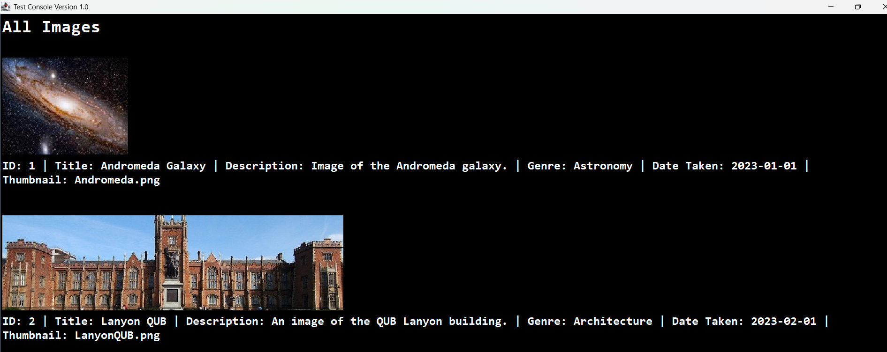
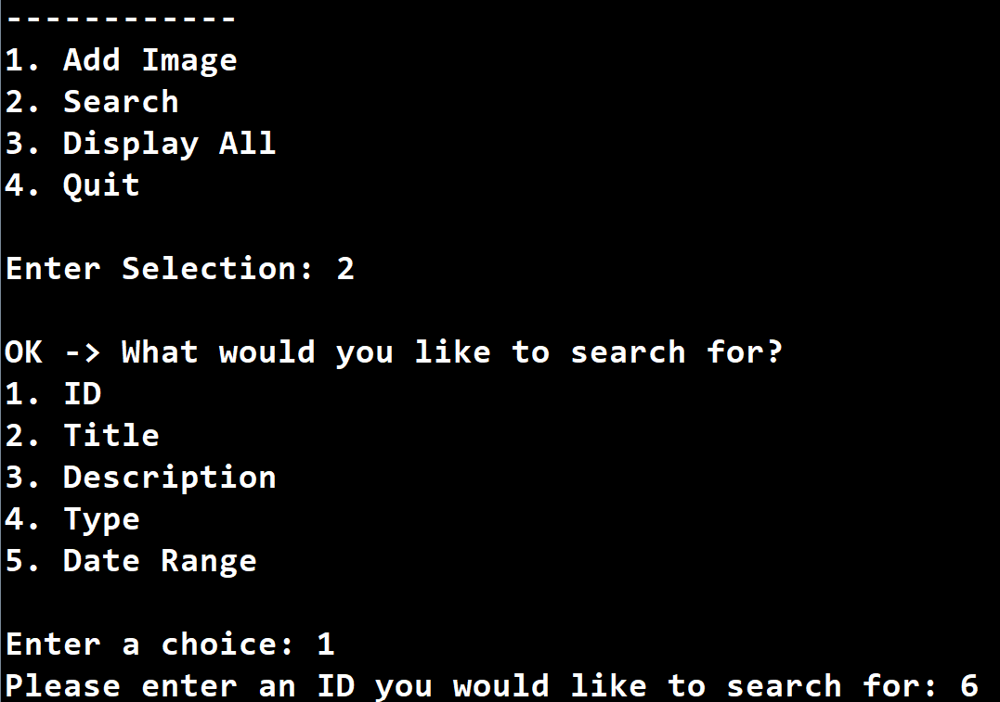
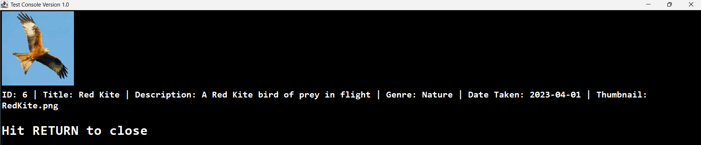

# QUB Image Manager

A Java application for managing a collection of photographic images, built for my Object Oriented Programming module (CSC1029) at Queen's University Belfast.

You can add images, search the collection in several ways, and view results as date-ordered albums. The project comes in two versions: a text-menu app and an enhanced version with thumbnails, fonts and colour.

## Features

- Add images (title, description, genre, date taken, thumbnail)
- Search by ID, title, description, genre or date range
- Display all images in a formatted list
- Results grouped into albums, sorted by date, and navigable forwards and backwards
- Sample data preloaded on startup
- Two interfaces over the same core code:
  - **QUBImages**: text menu application (Part 1)
  - **QUBMediaImages**: enhanced console UI with images, fonts and colour (Part 2)

## Core classes

| Class | Purpose |
|---|---|
| `ImageRecord` | A single image with a unique ID and its details |
| `ImageType` | Enum of genres (Astronomy, Architecture, Sport, Landscape, Portrait, Nature, Aerial, Food, Other) |
| `ImageManager` | Holds the whole collection and handles adding and searching |
| `ImageAlbum` | A date-ordered set of images returned from a search, with `getFirst()`, `getNext()` and `getPrevious()` |

## Screenshots

### Displaying images

The **Display All** option lists every image in the collection, showing each thumbnail alongside its ID, title, description, genre, date taken and filename.

### Searching for images

<table>
  <tr>
    <td width="45%"></td>
    <td width="5%" align="center"><b>&rarr;</b></td>
    <td width="50%"></td>
  </tr>
</table>

The search menu offers five ways to look up an image: ID, title, description, type or date range. Here, searching by ID with `6` returns the matching record, displayed with its thumbnail and full details.

## Notes

- Built using core Java only (`Scanner`, `LocalDate`, limited `ArrayList`), as required by the assignment.
- Written for CSC1029 - Object Oriented Programming (2025/26). The university-provided libraries are not included.

## Author

**Harry Larkin** · Computer Science Student, Queen's University Belfast
